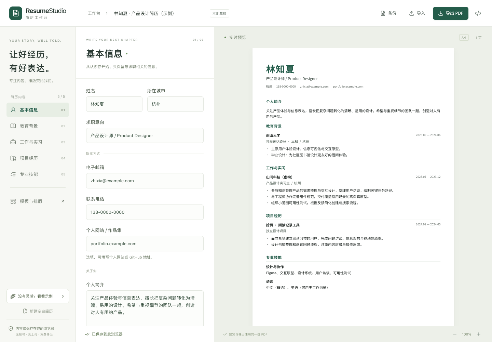

# ResumeStudio

一个免登录的开源简历工作台。填写经历、选择排版，在浏览器内制作一份简洁专业的中英文简历。

**[在线体验 →](https://xpm03.github.io/ResumeStudio/)** · [GitHub 仓库](https://github.com/xpm03/ResumeStudio) · [参与贡献](docs/contributor-tasks.md)

**当前版本：v0.1.0 初始功能版。** 本地与 GitHub Actions 验证通过，已发布 GitHub Pages；公网编辑、PDF 下载和备份恢复流程已复核。构建记录见 [Actions](https://github.com/xpm03/ResumeStudio/actions)。



## 已实现功能

- 免登录使用，简历内容保存在浏览器本地。
- 结构化编辑教育、经历、项目与技能，实时预览 A4 简历。
- 两款原创单栏模板、主题色、字号、行距和页边距调整。
- 本地中文字体、自动分页和文字 PDF 导出；预览直接显示同一个 PDF。
- 条目和模块排序、模块隐藏、手机编辑/预览切换。
- 自动保存和 JSON 备份恢复。
- 损坏草稿恢复提示、导入校验和覆盖前备份。

应用不上传简历、不接入统计 SDK，也不调用 AI。示例资料均为虚构。**清理浏览器数据可能丢失草稿，请定期导出 JSON 备份。**

## 环境与启动

使用 Node.js 24、React、TypeScript、Vite、React-pdf 和 PDF.js。应用是纯静态前端，无需 Python 服务、数据库、Docker 或云服务器。

首次克隆：

```sh
git clone https://github.com/xpm03/ResumeStudio.git
cd ResumeStudio
conda env create -f environment.yml
conda activate resumestudio
npm ci
npm run dev
```

本机已存在 `resumestudio` 环境时直接激活，继续使用同一环境。依赖变更时运行 `conda env update -f environment.yml` 和 `npm ci`。其他开发者也可直接使用 Node.js 24，不强制安装 Conda。

开发地址以终端输出为准，默认 `http://127.0.0.1:5173/`。生产构建与预览：

```sh
npm run build
npm run preview
```

## 测试

```sh
npm test
npx playwright install chromium
npm run test:e2e
```

端到端测试自动构建并启动临时生产预览服务，覆盖编辑、保存恢复、备份导入导出、实际 PDF 文本与手机布局。可通过 `PLAYWRIGHT_BROWSERS_PATH=.tools/browsers` 将测试浏览器下载隔离在项目内。

检查中文 PDF 与字体时，在开发环境中额外安装 Python 工具：

```sh
python -m pip install -r scripts/requirements.txt
npm run test:pdf
```

该检查生成一页与四页中英混排样例，验证 A4、文本、嵌入字体和页面边界，PNG 位于 `.tools/pdf-check/`。这些 Python 包只用于开发核验。GitHub Actions 会执行相同检查，通过后发布 Pages。

## 当前边界

- 一份本地工作草稿；跨设备使用 JSON 备份恢复。没有云同步或账户。
- 首次排版需加载约 21 MB 的中文字体，弱网可能较慢；支持字体缓存，冷启动体积仍待优化。
- JSON 仅支持本项目 v1 格式，最大 1 MB；没有 PDF、Word 或其他简历工具的直接导入。
- 桌面与手机 Chromium 已验证；Safari、Firefox 和复杂 Unicode 字形仍需更多实测。
- 不保证离线启动，也不宣称保证录用或所有 ATS 通过。投递前请打开导出的 PDF 检查内容与分页。

## 开始了解项目

- [实施计划与验收标准](Plan.md)
- [GitHub 参考项目调研](docs/reference-research.md)
- [实现与设计说明](docs/architecture.md)
- [参与贡献](CONTRIBUTING.md)
- [适合分工的小任务与 AI 协作提示](docs/contributor-tasks.md)
- [第三方许可](docs/third-party-notices.md)
- [开发协作约定](AGENTS.md)

本项目从新的规划基线开始开发，原科研复现平台已停止。本地恢复归档不属于本项目交付内容，不会上传。

## 许可证

本项目原创内容采用 [MIT](LICENSE)。参考项目和未来引入的字体、图标等资源保留其各自许可证；本仓库未复制参考项目源码。
